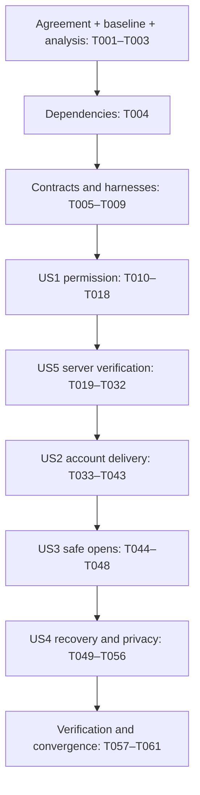

# Tasks: Mobile Push Notifications (WEA-29)

**Input**: [spec.md](spec.md), [plan.md](plan.md), [research.md](research.md), [data-model.md](data-model.md), [contracts](contracts/scenarios.md), [quickstart.md](quickstart.md).

**Branch**: `feat/WEA-29/onesignal-push`. All paths below are repository-relative. New files are proposed targets; existing auth/localization paths were verified read-only on prerequisite PR #13. The plan and tasks both use the existing `src/auth` and `src/localization` paths; no relocation is intended.

**Tests**: Required by FR-012, the evidence contracts and repository TDD rules. Each behavior follows real RED → minimum GREEN → REFACTOR. A RED task is complete only after a runnable test fails for the expected absent behavior; missing imports/tooling do not count. Each implementation task includes targeted GREEN and evidence recording before moving on. If an existing behavior already satisfies an added regression case, record that passing baseline; do not manufacture a failure or claim a RED that did not occur. New authored behavior still requires its own failing assertion before edits. Where a task explicitly contains both RED and implementation, record the failing run before editing behavior.

**Format**: `- [ ] Tnnn [P?] [USn?] Description with file path`. `[P]` permits execution only with completed prerequisites and disjoint files; it never permits implementation before its RED. Do not run all marked tasks across phases at once. Serialize edits to shared evidence/workflow files after independent tests finish.

**Current limits**: S01–S11 and the stack on PR #13 were explicitly confirmed on 2026-10-17; the ticket branch now contains that baseline. This document authorizes no inference of agreement, provider configuration, source execution or delivery success. Controlled test provisioning is an implementation acceptance activity; never change a shared/production provider app silently. Tasks can be generated and analyzed while execution gates remain closed.

## Phase 1: Setup and implementation gates

**Goal**: Prepare the authorized baseline, agreement and dependency adoption. These are future execution tasks; generation checks none of them off.

**Independent test / checkpoint**: Gate records must identify actual evidence, not infer agreement from this tasks invocation.

- [x] T001 Record explicit S01–S11 agreement and the selected server-confirmed scope in specs/006-onesignal-push/workflow.json; preserve scenariosConfirmed=false until the user actually agrees, and record prerequisite/provider/device limitations without blocking unrelated documentation work.
- [x] T002 Resolve the auth/store/i18n baseline through develop after PR #13 merges or an explicitly approved stack, verify the ticket branch and personal repository identity, and record actual base/head and reconciled source paths in specs/006-onesignal-push/workflow.json; preserve unrelated untracked files.
- [x] T003 Run speckit-analyze against specs/006-onesignal-push/spec.md, specs/006-onesignal-push/plan.md and specs/006-onesignal-push/tasks.md; resolve material findings and record the result in specs/006-onesignal-push/workflow.json before any source/dependency task. This is a future gate, not an analysis pass claimed by task generation.
- [x] T004 After all three gates above, adopt exact react-native-onesignal@5.5.15 in apps/mobile/package.json and exact @clerk/backend@3.23.0 plus jose@6.2.12 in apps/api/package.json; update pnpm-lock.yaml using the quickstart commands without unrelated upgrades or reinstall/purge workarounds.

## Phase 2: Foundational contracts and test harnesses

**Goal**: Establish public seams and runnable harnesses before any authored behavior. No complete service, reducer or provider behavior is hidden in scaffolding.

**Independent test / checkpoint**: All harnesses load and existing tests still run; unimplemented behavior remains explicitly failing in subsequent RED tasks.

- [x] T005 Define readonly notification context/state and consumer-owned interfaces in apps/mobile/src/features/notifications/domain/notification-models.ts, apps/mobile/src/features/notifications/application/notification-ports.ts and apps/mobile/src/features/notifications/index.ts: context contains “rootLease”, “generation”, “sessionId”, “accountId”; permission is “undetermined”, “allowed”, “denied”, “restricted”, “unavailable” with “canRequest” and observation revision; visible states are hidden/permission-needed/disabled/pending/ready/unavailable. Publish contracts without implementing transitions.
- [x] T006 [P] Define SessionAuthenticator, IdentityGrantSigner, ProviderReadinessReader, RequestBudget and Clock interfaces and canonical runtime symbols in apps/api/src/modules/authentication/application/session-authenticator.ts, apps/api/src/modules/notifications/application/notification-ports.ts and apps/api/src/modules/notifications/notifications.tokens.ts; domain/application imports no framework, HTTP or Prisma types.
- [x] T007 Define versioned native operation/event envelopes in apps/mobile/src/native/NativeWeaveNotifications.ts, native SessionAuthorizedTransport contracts in apps/mobile/android/app/src/main/java/si/tryweave/auth/SessionAuthorizedTransport.kt and apps/mobile/ios/Weave/Auth/SessionAuthorizedTransport.swift; operations are acquire/release/reconcile/enable/refresh/openSettings, requests carry lease/generation, readiness requests additionally carry attemptId, and events also carry installation revision. Readiness results echo attemptId and integer remainingValidityMs in 0–60000, never absolute native clock values; no credential-returning JS operation exists.
- [x] T008 Prepare runnable controlled-clock/deferred-response fakes and non-behavioral placeholders in apps/mobile/src/features/notifications/testing/fakes.ts, apps/api/test/notifications-fixtures.ts, apps/mobile/android/app/src/test/java/si/tryweave/notifications/NotificationFakes.kt and apps/mobile/ios/WeaveTests/NotificationFakes.swift; extend apps/mobile/scripts/ios-native-tests.sh and apps/mobile/scripts/ios-host-contracts.sh to discover future notification tests without dropping auth coverage. Provide compiling public placeholders that return unimplemented/denied outcomes where needed; do not build target behavior in the harness. Verify harness loading separately from RED assertions.
- [x] T009 Create the trace/evidence ledger in specs/006-onesignal-push/evidence.md with S01–S11, command/timestamp/assertion/result/refactor fields and explicit unperformed device/provider rows; do not populate outcomes before execution. Each subsequent RED/GREEN task appends its own evidence after running.

## Phase 3: US1 — Choose whether to receive notifications (P1)

**Goal**: Expose accessible explicit permission controls and accurate permission/pending states. This is the first demonstrable increment.

**Independent test / checkpoint**: S01–S02: user Enable produces one platform request; launch/sign-in/foreground/Retry produce none; denial/settings changes preserve Home and normal auth. Ready stays impossible without US5 confirmation.

- [x] T010 [P] [US1] Write and run behavioral RED for S01–S02 through NotificationController in apps/mobile/src/features/notifications/permission.test.ts: explicit Enable, double tap coalescing, denied/dismissed/restricted/provisional permission, Android without runtime prompts, settings return and no automatic prompts; import/harness failures are not RED.
- [x] T011 [P] [US1] Write and run behavioral RED for S01–S02 through Home controls in apps/mobile/src/features/notifications/notification-controls.test.tsx: explanation, meaningful roles/labels, hidden when signed out, busy/disabled behavior, normal actions preserved and no ready from allowed permission alone.
- [x] T012 [US1] Implement permission transitions and the vanilla-store adapter in apps/mobile/src/features/notifications/application/notification-controller.ts and apps/mobile/src/features/notifications/infrastructure/zustand-notification-state-store.ts to pass the controller tests; preserve “Permission decisions survive root reconstruction only through the platform; ready never survives a new root by local persistence.” In-flight state disables duplicate actions; keep domain/application framework-free.
- [x] T013 [US1] Implement the status/control component in apps/mobile/src/features/notifications/presentation/notification-controls.tsx and catalog entries in apps/mobile/src/localization/resources/en.ts using every key/copy in contracts/native-and-ui.md; reuse primitives/tokens and typed catalog conventions, and pass the UI tests without embedding display strings in domain state.
- [x] T014 [P] [US1] Write and run native behavioral RED for S01–S02 in apps/mobile/android/app/src/test/java/si/tryweave/notifications/NotificationPermissionTest.kt for explicit permission/settings dispatch, repeat requests and platform state normalization.
- [x] T015 [P] [US1] Write and run native behavioral RED for S01–S02 in apps/mobile/ios/WeaveTests/NotificationPermissionTests.swift for explicit permission/settings dispatch, provisional/restricted observations and duplicate requests.
- [x] T016 [US1] Implement permission/settings adapters in apps/mobile/android/app/src/main/java/si/tryweave/notifications/NotificationPermissionAdapter.kt and apps/mobile/ios/Weave/Notifications/NotificationPermissionAdapter.swift to pass native REDs; only Enable can invoke requestPermission or optIn that may prompt, while observation/activation/Retry remain silent.
- [x] T017 [US1] Write and run composition RED in apps/mobile/src/features/notifications/notification-runtime.test.ts and apps/mobile/src/features/notifications/notification-root.test.tsx for root disposal, one validated-auth subscription and no notification-caused auth operations; then implement apps/mobile/src/features/notifications/notification-runtime.ts, wire apps/mobile/App.tsx and apps/mobile/src/auth/presentation/home-screen.tsx through published contracts, extending apps/mobile/src/auth/presentation/auth-context.tsx only if a public reader accessor is required. Capture actual RED before those implementation edits.
- [x] T018 [US1] Refactor the US1 slice while targeted JS/native tests remain green and record S01–S02 commands/results in specs/006-onesignal-push/evidence.md; independently demonstrate permission UI with a controlled platform adapter and label it as a demo, not real push acceptance.

## Phase 4: US5 — Trust notification readiness (P1)

**Goal**: Implement authenticated signing and fresh server verification before account delivery can claim ready. This P1 story precedes US2 because US2 depends on its endpoints.

**Independent test / checkpoint**: S11: the composed API confirms only an exact eligible installation of the authenticated active account; invalid/expired/other-account/stale records never produce ready. Native/mobile acceptance follows in US2.

- [x] T019 [P] [US5] Write and run S11 behavioral RED in apps/api/test/notification-authentication.test.ts for signature/expiry/not-before, trusted issuer, subject/session ownership, active/task-free state, revoked/pending sessions, allowed azp, configured audience, bearer-only native tokens without azp, no cookie fallback, and verification outage; test through SessionAuthenticator and the composed HTTP boundary.
- [x] T020 [US5] Implement the Clerk adapter and guard in apps/api/src/modules/authentication/infrastructure/clerk-session-authenticator.ts, apps/api/src/modules/authentication/presentation/session.guard.ts and apps/api/src/modules/authentication/authentication.module.ts to pass authentication REDs; derive external ID from verified Clerk account, not Prisma User or caller fields, and wire interfaces using tokens/factories.
- [x] T021 [P] [US5] Write and run S11 PostgreSQL behavioral RED in tests/integration/notification-budget.test.mjs using two independent clients/processes: atomic reservation, ≥1-second provider spacing, grant/account cooldown, provider Retry-After, no resumed burst, unavailable storage, 24-hour account expiry, 100-row cleanup ceiling, one sweep per 60 seconds across replicas, retained non-expiring global rows, concurrent refresh-versus-delete, CLI one-shot behavior and cleanup failure isolation. Separate database/harness availability from behavioral failure.
- [x] T022 [US5] Implement NotificationRequestBudget with “key” (primary key), non-null “nextAllowedAt”, nullable “expiresAt” (null only for global provider/cleanup rows) and an expiry index in apps/api/prisma/schema.prisma and apps/api/prisma/migrations/20261016050000_notification_request_budget/migration.sql; implement atomic database-time reservations and bounded opportunistic expired-row cleanup in apps/api/src/modules/notifications/infrastructure/postgres-request-budget.ts. Preserve “at most one identity grant per account per 5 seconds and one verification attempt per account per second” and “Global View budget reserves at least 1 second between starts, including across API replicas”; keys are app scope or HMAC account scope spanning sessions, with no raw account/token/profile, and failed reservation storage fails closed. Set account expiresAt=nextAllowedAt+24 hours and extend it with cooldown; preserve “Rejected attempts do not extend retention” and “Global rows never expire”. Delete at most 100 eligible account rows per sweep, at most once per 60 seconds per app, with transactional concurrency rechecks and no request-time drain loop. Add the same one-shot cleanup operation in apps/api/src/scripts/cleanup-notification-budgets.ts and the notifications:cleanup script in apps/api/package.json; only aggregate output, no scheduler. Pass the PostgreSQL and maintenance-command tests.
- [x] T023 [P] [US5] Write and run S11 signing RED in apps/api/test/notification-identity-grant.test.ts for ES256 verification, configured app issuer/current account, token expiry with 14/15/16-second remaining-validity boundaries and time advancing during session validation, no injected claims, no email/phone claims, absent/malformed signing config and redacted errors; use generated test keys only.
- [x] T024 [US5] Implement grant use case and signer in apps/api/src/modules/notifications/application/issue-identity-grant.ts and apps/api/src/modules/notifications/infrastructure/jose-identity-grant-signer.ts to pass signing REDs; “Signed binding JWTs have a maximum five-minute life and never outlive the authenticated session token used to mint them.” Return native-only externalId/token/expiresAt, with ISO expiresAt and numeric seconds in JWT; immediately before signing require at least 15 whole seconds remaining, otherwise return 503 notifications_unavailable with retryAfterSeconds=5 and Retry-After: 5. Already-expired credentials fail authentication with 401. Compute exp=min(authenticatedTokenExp, floor(serverNowMs/1000)+300); no automatic refresh/reissue loop follows a short-validity response.
- [x] T025 [P] [US5] Write and run S11 provider/readiness RED in apps/api/test/notification-readiness.test.ts for exact account/subscription/type/token/enabled matching, optional app_id mismatch, malformed shape/oversized response, wrong/unknown/disabled subscription equivalence, 404/429/400/401/403/5xx/timeouts, no stale positive cache, same-context in-flight coalescing and released failed promises.
- [x] T026 [US5] Implement provider reader and verification use case in apps/api/src/modules/notifications/infrastructure/onesignal-readiness-reader.ts and apps/api/src/modules/notifications/application/verify-readiness.ts to pass REDs: fixed app-scoped endpoint, matching server-minted Bearer identity JWT, AndroidPush/iOSPush, enabled===true and nonempty token; cap response at 1 MiB and network at 5 seconds, acquire shared budget immediately before reading, no automatic retry on provider 400/401/403 and no worker queue or completed positive cache.
- [x] T027 [US5] Write and run S11 live HTTP RED in apps/api/test/notification-http.test.ts for both POST routes, strict empty grant body, canonical UUID subscriptionId, platform android/ios, rejected unknown/account/app/URL fields, JSON-only 4 KiB limit, no-store responses, 400/401/413/429/503 mappings and safe output/redaction; verify health remains usable with missing notification config.
- [x] T028 [US5] Implement DTO parsing/controllers/config and wiring in apps/api/src/modules/notifications/presentation/notifications.controller.ts, apps/api/src/modules/notifications/presentation/notification-input.ts, apps/api/src/modules/notifications/infrastructure/notification-config.ts, apps/api/src/modules/notifications/notifications.module.ts and apps/api/src/app.module.ts; expose /api/notifications/identity-grant and /api/notifications/readiness, returning status/checkedAt/validForSeconds with 60 only for ready and 0 for pending; public retryAfterSeconds/Retry-After agree and clamp 1–60 while retaining a longer server cooldown. Pass live HTTP REDs without returning provider profiles or raw errors.
- [x] T029 [US5] Add and run a compiled-runtime integration check in apps/api/test/notification-runtime.test.ts for production-module loading, ES256 signing and both composed routes; fix API module boundaries in apps/api/src/modules/notifications/notifications.module.ts and apps/api/tsconfig.json only as needed to pass with jose ESM under supported Node, without broad dependency/framework upgrades. Module/import failures are tooling failures, not behavioral RED; add a separate meaningful RED before any newly discovered behavior fix.
- [x] T030 [US5] Write and run S11 mobile confirmation RED with a fake monotonic clock in apps/mobile/src/features/notifications/readiness.test.ts: local registration never ready, exact context required, A→B→A, rotated subscription, permission loss/background/Reload invalidation, delayed response, deliberately different JS/native clock origins, wall-clock jumps, unknown/completed attempt IDs, duplicate ready callbacks, expiry without polling and no auth reset.
- [x] T031 [US5] Implement confirmation transitions in apps/mobile/src/features/notifications/domain/notification-models.ts and apps/mobile/src/features/notifications/application/notification-controller.ts; preserve “Absolute native monotonic timestamps never cross the bridge”, “Client expiration does not trigger polling” and “A delayed response older than the validity interval is discarded.” Record jsAttemptStart before native dispatch, accept only matching attemptId, and compute jsDeadline=min(jsAttemptStart+60000 ms, jsNow+remainingValidityMs); duplicates cannot renew it. Native uses its own request-start clock for the matching remainingValidityMs, never a shared absolute timestamp. Accept only current generation/installation revision, allowed permission and eligible local registration; pass mobile readiness REDs.
- [x] T032 [US5] Refactor US5 while HTTP, signer, PostgreSQL and mobile tests remain green; record S11 evidence and the budget cleanup operating procedure in specs/006-onesignal-push/evidence.md and specs/006-onesignal-push/quickstart.md. Server tests with provider doubles are not live OneSignal acceptance.

## Phase 5: US2 — Receive notifications for the correct account (P1)

**Goal**: Bind the current native-authenticated account securely and receive plain push on both platforms without disrupting existing work.

**Independent test / checkpoint**: S03–S05: two accounts/two installations, fresh server confirmation, late-response races, offline logout/recovery and foreground/background/normal terminated presentation; other installations remain eligible.

- [x] T033 [P] [US2] Write and run Android S03–S04 transport/coordinator RED in apps/mobile/android/app/src/test/java/si/tryweave/notifications/NotificationAccountTest.kt: pause token acquisition/HTTP across sign-out and A→B→A, reject redirects/untrusted origin and response bodies exceeding 16 KiB, enforce separate 5-second token/HTTP timeouts, reject stale JWT refresh and short-validity refresh loops, validate attempt correlation/remaining duration with distinct clock origins, no JS credentials, no unsigned fallback and immediate local logout; also cover native module operation allowlists, malformed envelopes, lease tags and credential-free events before bridge implementation.
- [x] T034 [P] [US2] Write and run iOS S03–S04 transport/coordinator RED in apps/mobile/ios/WeaveTests/NotificationAccountTests.swift with the same captured-session, stale-grant/verification, redirect, 16 KiB body cap, separate 5-second token/HTTP timeouts, no short-validity refresh loop, distinct-clock attempt/remaining-duration, credential-redaction and nonblocking logout matrix, plus native module operation allowlists, malformed envelopes, lease tags and credential-free events before bridge implementation.
- [x] T035 [US2] Implement Android session-bound HTTP and signed-account coordinator in apps/mobile/android/app/src/main/java/si/tryweave/auth/ClerkSessionAuthorizedTransport.kt and apps/mobile/android/app/src/main/java/si/tryweave/notifications/NotificationCoordinator.kt; use captured Session.fetchToken(GetTokenOptions()), fixed HTTPS paths, separate 5-second token/HTTP timeouts, 16 KiB decoded-body cap and session checks before dispatch/acceptance; emit only correlated attemptId/remainingValidityMs from the native monotonic deadline and never renew a completed attempt. Serialize current intent, suppress old eligibility, refresh JWT only for current session, keep SDK state separate from server acknowledgement and pass Android REDs.
- [x] T036 [US2] Implement iOS session-bound HTTP and signed-account coordinator in apps/mobile/ios/Weave/Auth/ClerkSessionAuthorizedTransport.swift and apps/mobile/ios/Weave/Notifications/NotificationCoordinator.swift; use captured Session.getToken(.init()), the same fixed-origin/session, separate 5-second token/HTTP timeouts, 16 KiB decoded-body cap, correlated attemptId/remainingValidityMs and current-intent serialization, never bridge tokens, and pass iOS REDs. “The process coordinator owns one desired account or signed-out state, one observer set and serialized app-issued commands.”
- [x] T037 [US2] Write and run S03–S04 JS bridge RED in apps/mobile/src/features/notifications/native-notification-gateway.test.ts for unknown/malformed envelopes, stale leases, sanitized events and current-context readiness; then implement apps/mobile/src/features/notifications/infrastructure/native-notification-gateway.ts only after behavioral RED. JS receives “registrationPresent”, “enabled”, “matchesCurrentAccount” and installation revision, never provider subscription ID/token/external ID/credentials; subscription replacement increments revision.
- [x] T038 [US2] Implement and wire the native bridge after its platform contract REDs in apps/mobile/android/app/src/main/java/si/tryweave/notifications/WeaveNotificationsModule.kt, apps/mobile/android/app/src/main/java/si/tryweave/notifications/WeaveNotificationsPackage.kt, apps/mobile/ios/Weave/Notifications/WeaveNotificationsModule.swift and apps/mobile/ios/Weave/Notifications/WeaveNotificationsModule.mm; extend apps/mobile/package.json codegen and native composition roots while preserving WeaveAuth mappings. Connect NotificationPlatform to the real adapter in apps/mobile/src/features/notifications/notification-runtime.ts and run bridge/auth regressions.
- [x] T039 [P] [US2] Write and run Android S05 presentation/config RED in apps/mobile/android/app/src/test/java/si/tryweave/notifications/NotificationPresentationTest.kt: default foreground display once, no duplicate manual display or form/auth effect, signed-out suppression and safely disabled missing config; test SDK calls via an injected native facade.
- [x] T040 [P] [US2] Write and run iOS S05 presentation/config RED in apps/mobile/ios/WeaveTests/NotificationPresentationTests.swift for the same display/config matrix with the real SDK integration boundary exercised separately by native builds.
- [x] T041 [US2] Implement native presentation/config adapters in apps/mobile/android/app/src/main/java/si/tryweave/notifications/NotificationPresentationAdapter.kt and apps/mobile/ios/Weave/Notifications/NotificationPresentationAdapter.swift; add required public config/channel/icon and push integration in apps/mobile/android/app/build.gradle, apps/mobile/android/gradle.properties, apps/mobile/ios/Podfile, apps/mobile/ios/Podfile.lock, apps/mobile/ios/Weave/Info.plist and apps/mobile/ios/Weave.xcodeproj/project.pbxproj plus the configured target entitlements. Use ONESIGNAL_DISABLE_LOCATION=true and modular locked SDKs, no NSE/App Group, no duplicate framework; pass presentation REDs and native integration builds.
- [x] T042 [US2] Write and run root-level S03–S05 regression tests in apps/mobile/src/features/notifications/account-delivery.test.tsx to verify valid auth-only binding, no ready before native-backed server proof, preserved form/auth/navigation and nonblocking sign-out; make only required composition/controller fixes after actual behavioral RED, then refactor green and record commands in specs/006-onesignal-push/evidence.md.
- [ ] T043 [US2] Execute S01–S05 and S11 controlled device/provider acceptance from specs/006-onesignal-push/quickstart.md and record it in specs/006-onesignal-push/evidence.md: verify Identity Verification availability/app compatibility and secure environment configuration, explicit permission/denial/settings journeys on both platforms (including Android with/without runtime prompts), exact fresh ready, two accounts/two installations, new targeting after remote eligibility acknowledgement, all three app states on both platforms, reconnect cleanup and unchanged second-device eligibility. Missing provider/device access leaves this task open; no production provisioning/sends.

## Phase 6: US3 — Open notifications safely (P1)

**Goal**: Keep every notification tap on the normal session-gated landing flow, with no payload-directed navigation or business action.

**Independent test / checkpoint**: S06–S07: cold/warm valid/expired/signed-out taps plus malformed, repeated, old-account and external Launch URLs produce only normal Login/Home/recovery.

- [x] T044 [P] [US3] Write and run Android S06–S07 launch behavior RED in apps/mobile/android/app/src/test/java/si/tryweave/notifications/NotificationOpenTest.kt: malicious HTTPS/custom URLs do not open externally and the ordinary activity still launches; include actual merged metadata and SDK intent behavior, not only a string-presence test.
- [x] T045 [P] [US3] Write and run iOS S06–S07 launch behavior RED in apps/mobile/ios/WeaveTests/NotificationOpenTests.swift: native URL suppression, ordinary app open, no callback replay or external open from malformed/old-account payloads.
- [x] T046 [US3] Write and run S06–S07 root-gate RED in apps/mobile/src/navigation/notification-open.test.tsx for valid/expired/checking/signed-out sessions, duplicate callbacks and unsupported payloads; assert zero payload-directed navigation, account change or business mutation and no protected-screen flash.
- [x] T047 [US3] Set Android com.onesignal.suppressLaunchURLs=true in apps/mobile/android/app/src/main/AndroidManifest.xml while leaving NotificationOpened.DEFAULT unchanged, and iOS Boolean OneSignal_suppress_launch_urls=true in apps/mobile/ios/Weave/Info.plist; enforce ignored tap instructions in native coordinators and apps/mobile/src/features/notifications/infrastructure/native-notification-gateway.ts only as required by REDs. Preserve apps/mobile/src/navigation/root-navigator.tsx as session authority; add no imperative navigation queue or tap-triggered login/refresh.
- [ ] T048 [US3] Run and refactor the US3 regression suite, then execute real cold/warm HTTPS/custom-scheme and duplicate/old-account tap probes on both platforms; record S06–S07 results in specs/006-onesignal-push/evidence.md, leaving unavailable physical/device cases open rather than inferring them from mocked launch tests.

## Phase 7: US4 — Keep the app usable when notifications are unavailable (P2)

**Goal**: Complete fault recovery, lifetime concurrency, English accessibility and privacy across the integrated feature. Basic safety defaults remain required in every earlier increment.

**Independent test / checkpoint**: S08–S10: fault/Reload/account races never reset auth/forms, multiply effects or show false ready; English controls remain reachable and no secrets/private data appear in reviewed output.

- [x] T049 [P] [US4] Write and run S08–S09 behavioral RED in apps/mobile/src/features/notifications/recovery-lifecycle.test.tsx for offline/no-config/delayed setup, duplicate foreground events, Retry overlap, 401/429/503, coalescing, expiry without polling, root replacement/stale dispose and preserved auth/form state.
- [x] T050 [P] [US4] Write and run Android S08–S09 native lifetime RED in apps/mobile/android/app/src/test/java/si/tryweave/notifications/NotificationLifetimeTest.kt for process singleton/observer counts, JS suspension, stale root release, late callbacks, persisted SDK operations and startup signed-out suppression before rebind.
- [x] T051 [P] [US4] Write and run iOS S08–S09 native lifetime RED in apps/mobile/ios/WeaveTests/NotificationLifetimeTests.swift for equivalent Reload/process/account races and offline cleanup recovery without retained credentials.
- [x] T052 [US4] Implement bounded recovery and lease ownership fixes in apps/mobile/src/features/notifications/application/notification-controller.ts, apps/mobile/src/features/notifications/notification-runtime.ts and both native NotificationCoordinator files; preserve “An inactive/unknown auth snapshot immediately removes readiness and requests native suspension” and “Re-entering the same account still creates a new generation”. Permit at most one authored attempt per Retry/distinct activation, no observer retry loop, one active root lease and stale-root-safe release; pass lifecycle REDs and refactor green.
- [x] T053 [P] [US4] Write and run S10 English/accessibility RED in apps/mobile/src/features/notifications/accessibility.test.tsx and apps/mobile/src/localization/catalog.test.ts for every notification key, meaningful state announcements, no duplicate countdown announcements, labels/roles/busy states, enlarged-text reachability and shared token usage.
- [x] T054 [P] [US4] Write and run S10 privacy RED in apps/mobile/src/features/notifications/privacy.test.ts, apps/api/test/notification-privacy.test.ts, apps/mobile/android/app/src/test/java/si/tryweave/notifications/NotificationPrivacyTest.kt and apps/mobile/ios/WeaveTests/NotificationPrivacyTests.swift; exercise bridge/store/HTTP/provider-error/logging paths with sentinel credentials and private payloads, plus resolved location permissions/artifacts rather than source-only scanning.
- [x] T055 [US4] Implement only RED-required accessibility/privacy fixes in apps/mobile/src/features/notifications/presentation/notification-controls.tsx, apps/mobile/src/localization/resources/en.ts, native transport/coordinator adapters and apps/api/src/modules/notifications/infrastructure/notification-config.ts; disable SDK verbose logging, sanitize authored errors and retain native/server-only credentials. Preserve “No application persistence duplicates SDK token storage” and “Secret material is configuration, not table data”; run all privacy/accessibility tests green and refactor.
- [ ] T056 [US4] Execute actual S08–S10 airplane-mode logout/reconnect, unavailable backend/configuration, repeated Reload, two-account races, enlarged text, VoiceOver/TalkBack and sanitized log review on Android/iOS; record settings and outcomes in specs/006-onesignal-push/evidence.md, without treating queued OS notifications as a failed instantaneous-recall promise.

## Phase 8: Polish, verification and convergence

**Goal**: Verify the complete agreed feature and keep any unavailable external acceptance explicitly open.

**Independent test / checkpoint**: All S01–S11/FR-001–FR-013/SC-001–SC-008 must be traced to actual evidence; no inference from compilation replaces delivery.

- [x] T057 Audit module boundaries, public exports, interface/token injection, dependency locks, location exclusion, credential handling and scope against specs/006-onesignal-push/contracts/application.md and specs/006-onesignal-push/contracts/native-and-ui.md; record review in specs/006-onesignal-push/evidence.md, and fix new behavioral defects through a new recorded RED/GREEN slice before continuing.
- [x] T058 Run the full mobile/API/native/bundle/build commands from specs/006-onesignal-push/quickstart.md, compiled API checks, isolated PostgreSQL migration/integration and pnpm run verify; save exact results and environmental limitations in specs/006-onesignal-push/evidence.md. These commands must include new tests, not only the pre-feature suites.
- [x] T059 Complete the acceptance matrix and map every scenario/requirement/success criterion to commands or device/provider evidence in specs/006-onesignal-push/evidence.md; keep missing beta access, signing, credentials, devices or failed delivery checks unchecked and update specs/006-onesignal-push/workflow.json truthfully.
- [x] T060 Run speckit-converge for this feature and write specs/006-onesignal-push/convergence.md; append remaining work to specs/006-onesignal-push/tasks.md and execute authorized remediation with meaningful RED/GREEN before claiming feature completion.
- [x] T061 Update specs/006-onesignal-push/quickstart.md and specs/006-onesignal-push/workflow.json with final configuration/operations guidance and verified status; prepare the review handoff with ticket, spec/evidence links, actual branch/base, one-line Conventional Commit policy and personal author/committer verification. Do not publish/deploy or mark the Linear ticket done merely because tasks were generated.

## Dependencies and execution order

This is the recommended single-owner execution order. US5 retains its spec label while moving before US2 to satisfy the server dependency; all P1 work precedes P2. T003 may run while T001/T002 remain pending; T004 requires all three gates. T005/T006 may proceed together after T004; T007 follows the mobile contracts, T008 follows published interfaces, T009 prepares evidence before story work.

| Story | Required predecessor / dependency details                                                                                                                                       | Completion boundary                                                                                                            |
| ----- | ------------------------------------------------------------------------------------------------------------------------------------------------------------------------------- | ------------------------------------------------------------------------------------------------------------------------------ |
| US1   | Foundation. T010 → T012; T011 → T013; T014 + T015 → T016; T012/T013/T016 → T017 → T018                                                                                          | Permission/control demo is independent with a fake platform. Live permission acceptance is T043 after real bridge integration. |
| US5   | Foundation plus US1 controller for mobile proof handling. T019 → T020; T021 → T022; T023 → T024; T025 → T026; T020/T022/T024/T026 → T027 → T028 → T029; T030 → T031; all → T032 | API and controller contracts are independently testable with provider/native doubles. Real server/native readiness is T043.    |
| US2   | US1 + US5. T033 → T035; T034 → T036; both platform REDs and implementations plus T037 → T038; T039 + T040 → T041; T038/T041 → T042 → T043                                       | Actual account targeting and presentation require configured provider/devices. Do not label the story accepted without T043.   |
| US3   | Foundation suffices to author standalone tests; integrate after US2 bridge/config to avoid overlapping native changes. T044/T045/T046 → T047 → T048                             | Ordinary auth-gated cold/warm opens, no URL escape, evidenced on both platforms.                                               |
| US4   | Integrated US1/US5/US2/US3 for end-to-end fault behavior. T049/T050/T051 → T052; T053/T054 → T055; all → T056                                                                   | Fault, lifecycle, privacy and accessibility acceptance with existing app state preserved.                                      |

Each implementation task also depends on all contracts/harnesses it uses; use-case composition T024/T026 consumes T020/T022 as applicable. RED tests against interfaces may use controlled doubles while these implementations are incomplete. T029 is a runtime verification task, not a license to count a module loading failure as behavioral RED.

External acceptance tasks T043, T048 and T056 may remain open while other independent implementation/testing proceeds. They are completion gates, not reasons to stop all useful work. T057–T058 can run to expose issues while device access is pending, but T059–T061 must not claim acceptance/convergence success with missing evidence. Shared native config, controller, catalog, composition and evidence files have one writer at a time.

## Parallel examples by story

Only start a batch once its stated prerequisites are complete. A `[P]` marker denotes a safe scheduling opportunity, not a command to spawn agents.

| Story | Parallel batch                                                                                               | Preconditions and shared-file boundary                                                                                  |
| ----- | ------------------------------------------------------------------------------------------------------------ | ----------------------------------------------------------------------------------------------------------------------- |
| US1   | T010 permission tests + T011 control tests; later T014 Android + T015 iOS                                    | Foundation/harness complete; do not concurrently edit controller/catalog implementations or the common evidence ledger. |
| US5   | T019 auth tests + T021 database tests + T023 signer tests + T025 provider tests                              | Public API ports/fakes complete; separate test files/database fixture ownership; serialize shared fixture changes.      |
| US2   | T033 Android account tests + T034 iOS account tests; later T039 Android presentation + T040 iOS presentation | US5 endpoints/contracts ready; no shared codegen or configuration edits in these test batches.                          |
| US3   | T044 Android launch tests + T045 iOS launch tests                                                            | Native harness/bridge ready; T047 owns shared platform config changes after the tests.                                  |
| US4   | T049 JS lifecycle + T050 Android lifetime + T051 iOS lifetime; later T053 accessibility + T054 privacy       | Integrated baseline ready; test-only batches use separate files, then shared controller/native/UI fixes are serial.     |

No parallel task runs against an unfinished implementation dependency. Per-platform production adapters could later be split into independent tasks, but current combined wiring tasks are deliberately unmarked to avoid build/config collisions.

## Scenario and contract coverage

| Scenarios | Story tasks                                   | Public contract / final evidence                                                              |
| --------- | --------------------------------------------- | --------------------------------------------------------------------------------------------- |
| S01–S02   | T010–T018, T043                               | Permission/UI/native ports; actual permission and settings matrix                             |
| S03–S05   | T033–T043                                     | Session-authorized transport, signed coordinator, plain presentation and two-device targeting |
| S06–S07   | T044–T048                                     | Native launch suppression and existing RootNavigator authority                                |
| S08–S10   | T049–T056, plus fail-safe defaults throughout | Recovery/lifetime, English inventory, privacy and actual accessibility checks                 |
| S11       | T019–T032, T033–T043                          | Live HTTP auth/signing/readiness, PostgreSQL concurrency and current native proof             |

T005/T007/T012/T031/T037/T052 cover the data model's context, permission, installation observation, readiness and visible-state constraints. T021–T024 cover budget records and credential lifetime. T057–T061 reconcile every FR and SC against actual results. Contract details remain authoritative in [application.md](contracts/application.md), [backend.md](contracts/backend.md), [native-and-ui.md](contracts/native-and-ui.md) and [scenarios.md](contracts/scenarios.md).

## Implementation strategy

1. **First demonstrable increment**: Foundation + US1 (T001–T018), with an injected platform adapter. Users can review English permission controls; do not claim functional push or server-ready delivery from this demo.
2. **Server increment**: US5 supplies independently testable authenticated grants/readiness and shared capacity control. Keep provider/native delivery acceptance separate.
3. **End-to-end push increment**: US2 connects native identity, server verification and real presentation; US3 completes safe opens. No production rollout is implied by completing either increment.
4. **Feature acceptance**: Complete US4 plus all cross-cutting, device/provider, full verification and convergence work. Because account isolation and safe failure are mandatory, a shipping MVP cannot drop those requirements even though US1 is the first demo.

Tasks are intentionally unchecked. Generated task count: **61** — setup 4, foundation 5, US1 9, US5 14, US2 11, US3 5, US4 8, polish 5. Next workflow step is speckit-analyze. No source implementation, test execution evidence, provider action or PR is produced by task generation.

## Phase 9: Convergence

- [ ] T062 Complete the controlled provider and physical Android/iOS acceptance tracked in T043, T048 and T056, per FR-012, FR-001–FR-011, FR-013, SC-001–SC-008 and S01–S11 (partial; HIGH): configure the isolated IV/APNs/FCM/API/signing environment from specs/006-onesignal-push/quickstart.md, disable provider remote diagnostics, and record actual permission, exact readiness, two-account/two-installation targeting, foreground/background/terminated receipt, cold/warm safe taps, offline/logout/Reload, enlarged-text/screen-reader and sanitized-log outcomes in specs/006-onesignal-push/evidence.md. Keep unperformed or failed outcomes open; the user explicitly deferred this setup.
